# Credit Risk Scorecard for Bank GoodCredit

Predicting which credit-card customers are likely to become **"bad"** (reach 30+ days past due), so the bank can lower default risk by scoring customers on a **300–900 credit score**.

> **One-line result:** a heavily regularised logistic regression reaches a cross-validated **Gini of 43.3 ± 2.6** (reference model: 37.9). The riskiest 10% of customers have a **12% bad rate (3.6× the average)** and the riskiest 20% contain **58% of all bad customers**. With only 33 bad customers, the 95% confidence interval is wide (**≈ 25 to 64**), so treat this as promising evidence rather than proof.

---

## 1. Contents

| Section | |
|---|---|
| [2. Problem and data](#2-problem-and-data) | what was asked, what was provided |
| [3. Key findings](#3-key-findings) | the results that matter |
| [4. Data cleaning](#4-data-cleaning) | every decision, with reasons |
| [5. Feature engineering](#5-feature-engineering) | bureau and application features |
| [6. Exploratory analysis](#6-exploratory-analysis) | charts and insights |
| [7. Modelling and evaluation](#7-modelling-and-evaluation) | models, validation, results |
| [8. Final feature matrix](#8-final-feature-matrix) | features with gain |
| [9. Limitations and honest caveats](#9-limitations-and-honest-caveats) | what this can and can't claim |
| [10. Repository layout and how to run](#10-repository-layout-and-how-to-run) | |

---

## 2. Problem and data

**Business problem.** Bank GoodCredit wants a credit score for its current credit-card customers. The target is `Bad_label`: **1** if the customer reached the 30+ days-past-due bucket, **0** otherwise.

**Evaluation requested:** (1) data-exploration insights and decisions, (2) a feature matrix with gain, (3) model Gini and rank ordering against a reference Gini of **37.9**.

| Table | Rows | Customers | Content |
|---|---|---|---|
| `demographics_raw.csv` | 1,000 | 1,000 | Application/demographic fields `feature_1…feature_79` (anonymised) + `Bad_label` |
| `accounts_raw.csv` | 1,000 | 123 | Credit-bureau tradelines: type, dates, balance, limits, month-by-month payment history |
| `enquiries_raw.csv` | 1,000 | 51 | Credit enquiries: date, purpose, amount |

Tables are joined on `(customer_no, dt_opened)`.

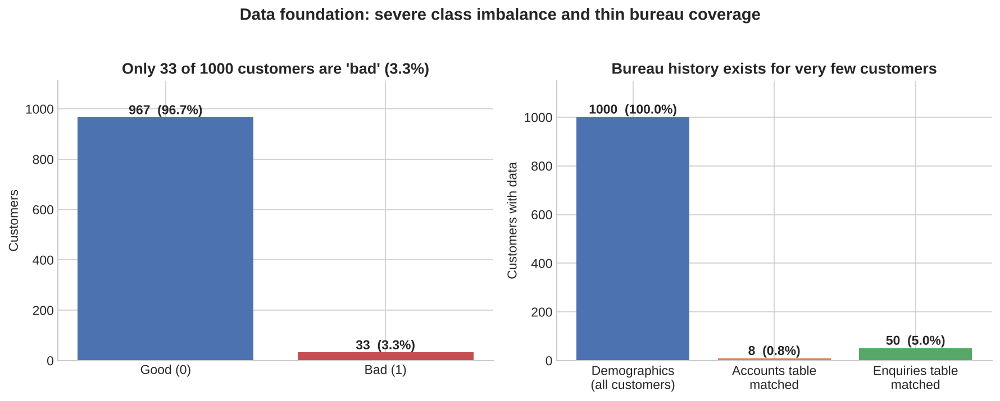

**Two facts shape the whole project:**

1. **Severe imbalance:** 33 bad vs 967 good (3.3%).
2. **Thin bureau coverage:** only **8** customers match the accounts table (none is bad) and **50** match the enquiries table (4 are bad). The bureau-style features suggested for this task can therefore add almost no signal in this sample. The model is driven mainly by application data.

---

## 3. Key findings

| # | Finding | Evidence |
|---|---|---|
| 1 | Model beats the 37.9 reference on cross-validation | CV Gini **43.3 ± 2.6** (5 × 5-fold repeated, stratified) |
| 2 | Rank ordering is strong at the top | Decile 10: **12%** bad (reference 11.7%); decile 9: **7%** (reference 8.1%) |
| 3 | Risk is concentrated | Top 20% of customers hold **58%** of bad customers; KS = **43** |
| 4 | Lowest credit-score quintile is clearly riskier | **10.0%** bad vs 1.5–2.0% in the other four quintiles |
| 5 | The result is statistically real but imprecise | Permutation-test p = 0.001; bootstrap 95% CI 25–64 |
| 6 | Simple beats complex | Regularised logistic regression > random forest > gradient boosting |
| 7 | Card product is a strong separator | **Golf Card 23.3%** bad (n = 30), Insignia 6.9% (n = 58), Titanium Delight 2.4% (n = 903) |
| 8 | Missing income-type data is a warning sign | Customers with `feature_35` missing: **7.8%** bad vs 2.2% when present |
| 9 | Lower `feature_7` (limit/amount-like) means higher risk | Median 59,000 for bad vs 114,000 for good |
| 10 | Renters look safest, those living with parents riskiest | 1.1% vs 6.5% bad |

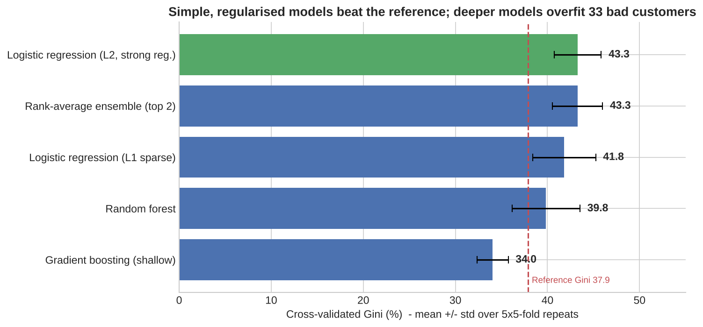
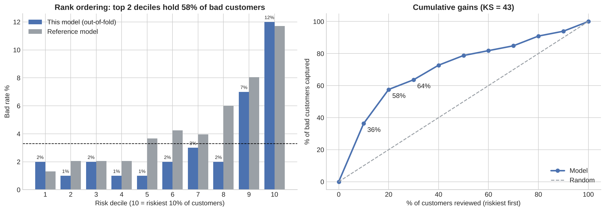

---

## 4. Data cleaning

Full machine-readable log: [`outputs/data_quality_log.csv`](outputs/data_quality_log.csv). Cleaning code: [`src/01_clean_data.py`](src/01_clean_data.py).

### Accounts
| Issue | Action |
|---|---|
| 5 exact duplicate rows | dropped |
| Payment-history strings wrapped in stray quotes (`"000000…""""`) | quotes stripped |
| History split across `paymenthistory1` + `paymenthistory2` | concatenated (recent → older months) |
| `amt_past_due` is 100% empty | dropped |
| `creditlimit`, `cashlimit`, `rateofinterest`, `paymentfrequency`, `actualpaymentamount` 76–88% empty | kept as NaN (they only apply to some products) |
| 2-digit years (`'03-Sep-65'` → 2065) | rolled back 100 years when in the future |
| 50 negative balances, 10 balances above high-credit amount, 1 last-payment-before-opened | **flagged, not removed** (can be genuine over-payments / reporting artefacts) |

### Enquiries
| Issue | Action |
|---|---|
| 1 blank record (IDs only) | dropped; that customer has no enquiry history |
| 40 exact duplicate rows | **kept**: repeated identical enquiries are a behavioural signal |
| Extreme amounts (up to 6.7 billion) | kept, `log1p`-transformed in modelling |

### Demographics
| Issue | Action |
|---|---|
| Constant/all-null columns (7) and columns >90% null (7) | dropped |
| Exact duplicate columns (`59=11`, `68=34`, `69=35`) | copies dropped |
| Personal/identifier fields (masked PAN, phone, email, DOB, job title) | **dropped for privacy**; safe features derived first (age, free-email flag, has-email) |
| Placeholder `1` in income-like `feature_35` (192 customers) | → NaN plus `income_missing` flag |
| `feature_3` missing for 97 customers | NaN plus flag; median-imputed **inside** each CV fold |
| Truncated labels in `feature_32` (`Paren`, `Compa`, `Rente`) | expanded to Parents / Company / Rented (assumption) |
| High-cardinality codes (pincodes, free text) | dropped from the clean file |

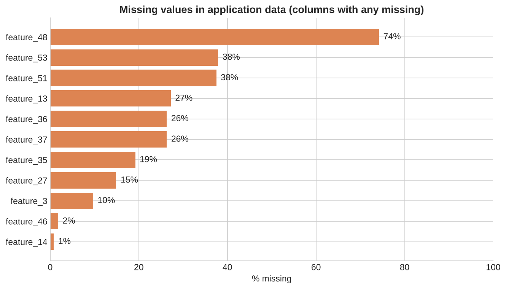

---

## 5. Feature engineering

Code: [`src/02_feature_engineering.py`](src/02_feature_engineering.py). Output: [`data/clean/customer_master.csv`](data/clean/customer_master.csv) (1 row per customer, 89 columns).

**Account features (per customer):** number of accounts / open / closed, total high credit, total balance, total credit limit, **balance-to-credit-limit ratio**, **utilisation trend**, mean and total gap between last-payment and open date, mean payment-history length, **average count of 1–29 days-past-due months**, total months at 30+ DPD, **minimum months until the first 30+ DPD**, worst DPD, share of secured accounts, number of credit cards.

**Enquiry features:** total enquiries, **count in last 90 and 365 days**, mean gap between enquiry and application date, days since the last enquiry, total/mean/max enquiry amount, number of distinct purposes, **most frequent purpose**, share of unsecured enquiries.

**Application features:** age at application, free-email flag, days from data entry to account opening, missing-value flags, plus the cleaned `feature_*` fields.

**Payment-history decoding (assumption):** each month is a 3-character token: `000`/`STD` = current, `XXX` = no data, any number = days past due (`900` is a cap for very severe delinquency). Most recent month comes first.

---

## 6. Exploratory analysis

### 6.1 Which segments carry risk?
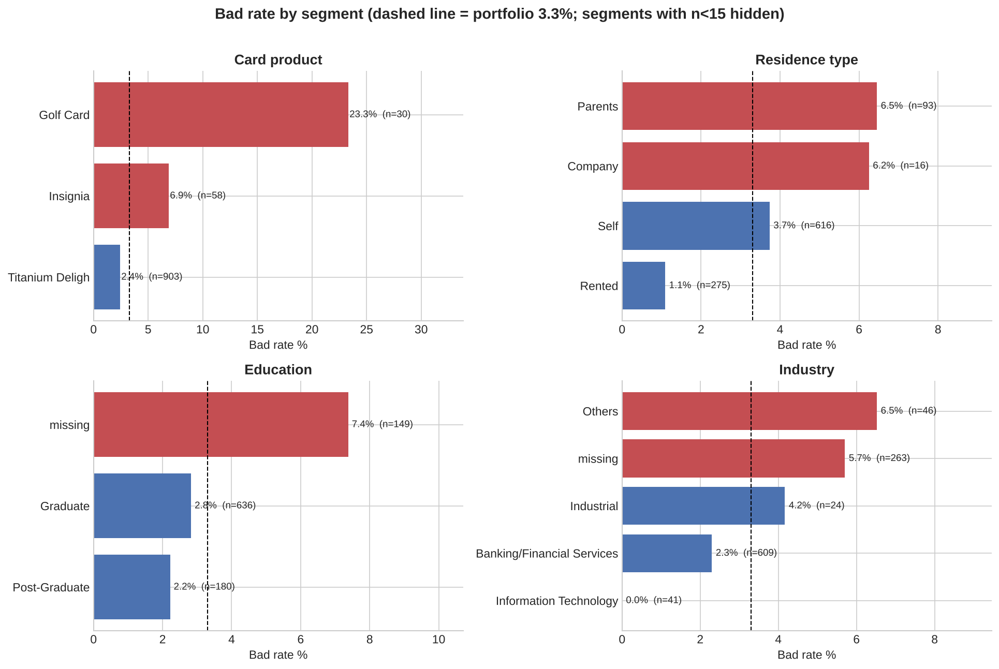

Segments with fewer than 15 customers are hidden because a bad rate on a handful of people is noise. Bad rates are differences in *this* sample; with 33 bad customers a segment such as Golf Card (7 bad of 30) deserves confirmation on more data.

### 6.2 Numeric drivers
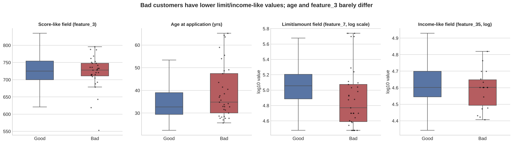

`feature_3` (range 553–796) looks like a score, **but on its own it has essentially no predictive power** (Gini ≈ 1). The much stronger signals are `feature_7`, `days_entry_to_open`, and `feature_52`.

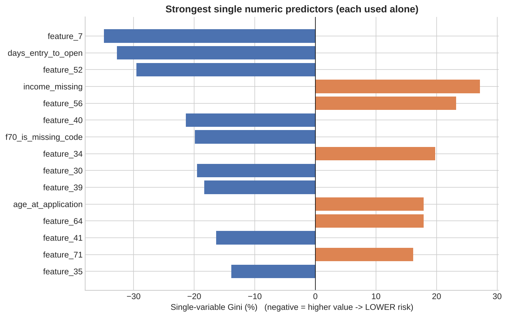
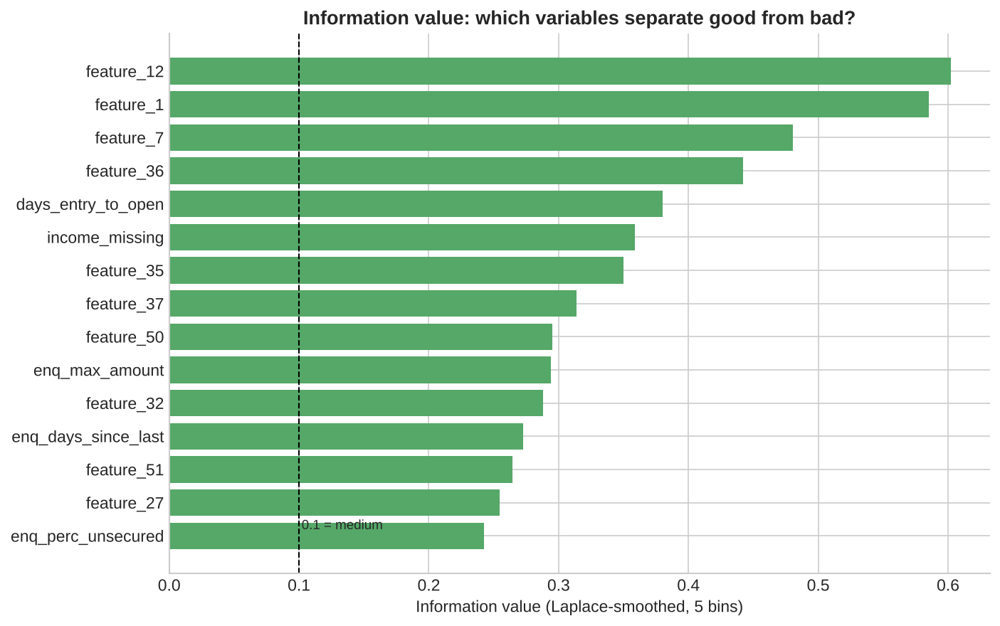

Information value (IV) tables: [`outputs/information_value.csv`](outputs/information_value.csv). IV above 0.5 is conventionally "suspiciously strong", which here mostly reflects only 33 bad customers spread across several levels, not a magic variable.

### 6.3 Time, accounts and enquiries
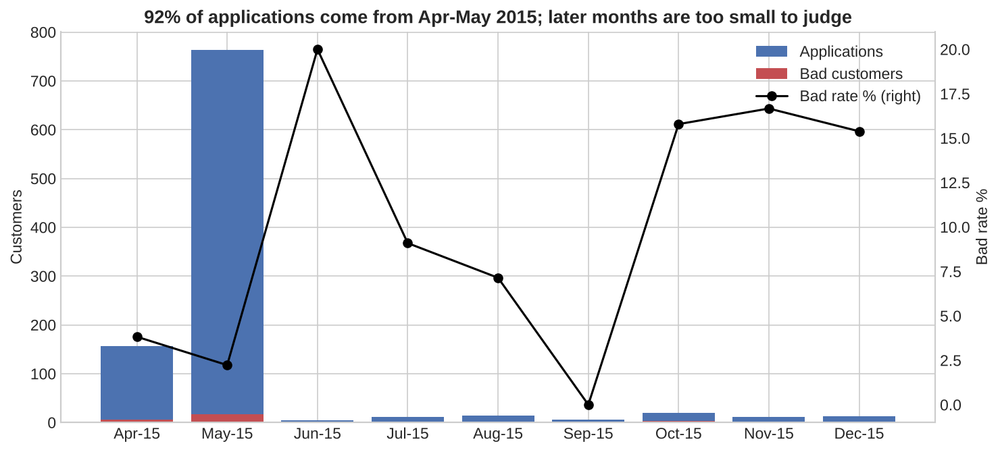
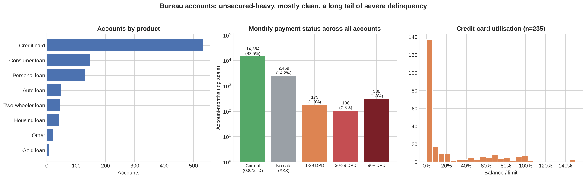
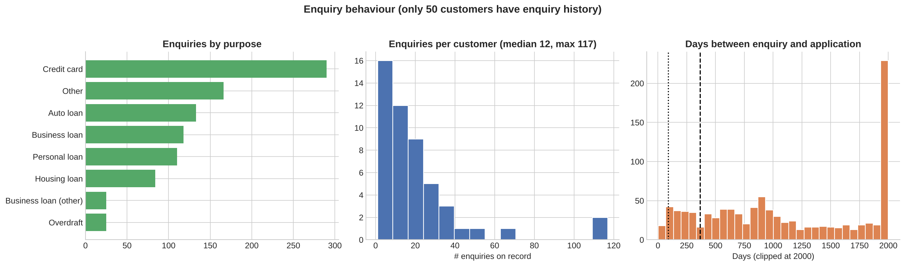

* 92% of applications are from April–May 2015, so a proper out-of-time validation is not possible.
* Bureau accounts are dominated by credit cards and personal/consumer loans; the large majority of account-months are current, with a thin but severe tail (some accounts reach several hundred days past due).

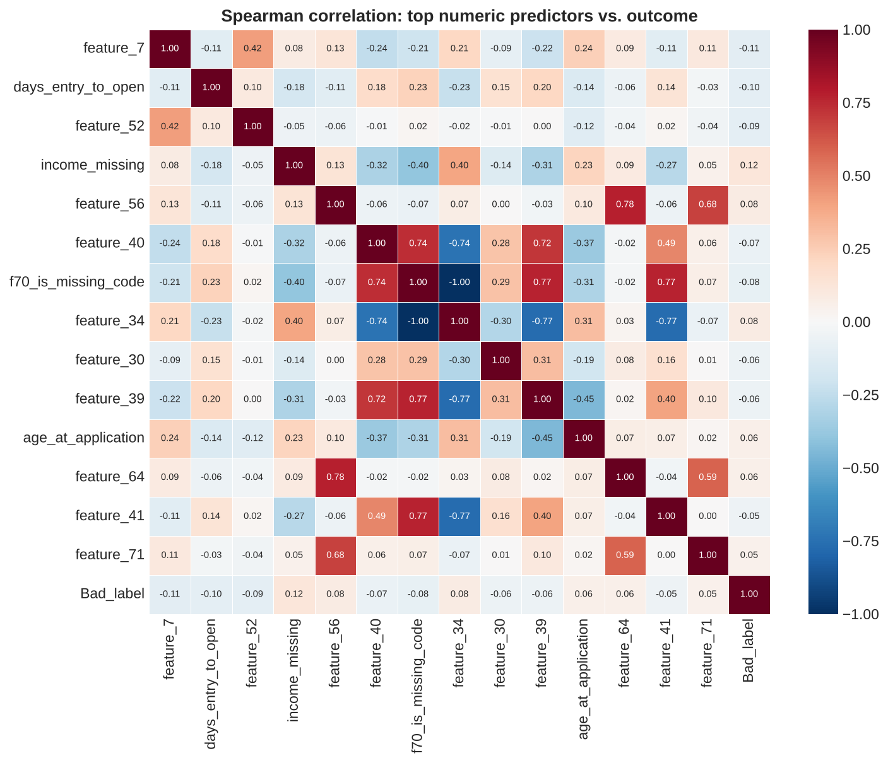

---

## 7. Modelling and evaluation

Code: [`src/03_modeling.py`](src/03_modeling.py), charts: [`src/05_model_charts.py`](src/05_model_charts.py).

### 7.1 Validation design (the part that matters most)
With 33 bad customers, one train/test split is a coin-flip (a 30% test set holds about 10 bad customers). So:

* **Repeated stratified 5-fold cross-validation, 5 repeats.** Every customer is scored by a model that never saw them.
* **All preprocessing is inside the pipeline** (imputation, scaling, encoding), so nothing leaks from validation folds.
* **Gini = 2·AUC − 1**, computed per repeat; mean ± std reported.
* Bootstrap confidence interval and a **permutation test** (is the model better than random?).

### 7.2 Models compared

| Model | CV Gini (mean ± std) |
|---|---|
| **Logistic regression (L2, strong regularisation)** | **43.3 ± 2.6** |
| Rank-average ensemble (top 2) | 43.3 ± 2.7 |
| Logistic regression (L1, sparse) | 41.8 ± 3.4 |
| Random forest | 39.8 ± 3.7 |
| Gradient boosting (shallow) | 34.0 ± 1.7 |
| *Reference model* | *37.9* |

The ensemble adds nothing over the best single model, so the simpler model is chosen.

### 7.3 Uncertainty
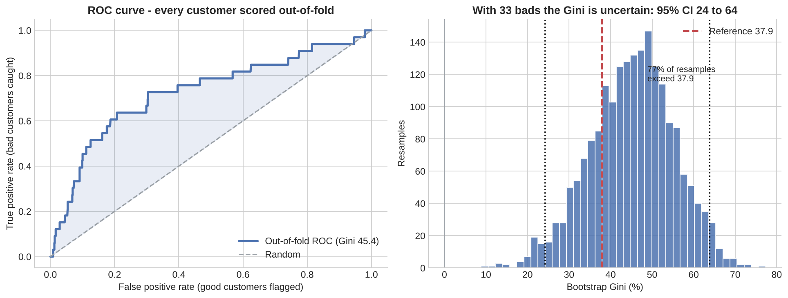

* Pooled out-of-fold Gini: **45.4** (rank-averaged across repeats, so slightly optimistic; **43.3** is the honest headline).
* 95% bootstrap CI: **24.7 to 63.9**. About 77% of resamples exceed 37.9.
* Permutation test p-value: **0.001** (the signal is not random).
* Single 70/30 hold-out: **37.7** for the chosen model (only 10 bad customers in the test set; individual models range 35–49 there, illustrating the noise).

### 7.4 Rank ordering

| Decile (10 = riskiest) | Customers | Bad | Bad rate | Lift | Cumulative bad captured |
|---|---|---|---|---|---|
| 10 | 100 | 12 | 12.0% | 3.6× | 36% |
| 9 | 100 | 7 | 7.0% | 2.1× | 58% |
| 8 | 100 | 2 | 2.0% | 0.6× | 64% |
| 7 | 100 | 3 | 3.0% | 0.9× | 73% |
| 6 | 100 | 2 | 2.0% | 0.6× | 79% |
| 5 | 100 | 1 | 1.0% | 0.3× | 82% |
| 4 | 100 | 1 | 1.0% | 0.3× | 85% |
| 3 | 100 | 2 | 2.0% | 0.6× | 91% |
| 2 | 100 | 1 | 1.0% | 0.3× | 94% |
| 1 | 100 | 2 | 2.0% | 0.6× | 100% |

The top two deciles match the reference closely. The lower deciles are not smoothly monotonic because each decile has only 1–3 bad customers; the **quintile** view ([`rank_ordering_quintiles.csv`](outputs/rank_ordering_quintiles.csv)) is steadier: 9.5% → 2.5% → 1.5% → 1.5% → 1.5%.

### 7.5 Credit score
Risk scores are mapped to a 300–900 scale (base 650 at 30:1 good-to-bad odds, 40 points to double the odds). The lowest quintile (≈ 484–631) has a **10.0%** bad rate; the other four quintiles have 1.5–2.0%.

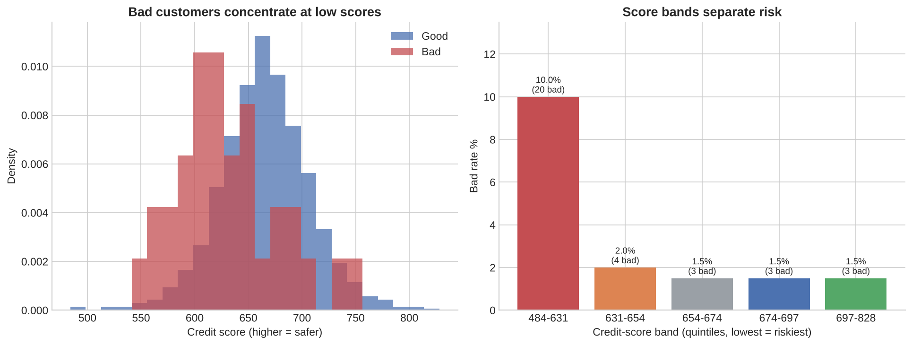

---

## 8. Final feature matrix

Gain = average of boosting and random-forest importance, normalised to sum to 1 across all 85 variables. The **permutation** column is the average AUC drop when the variable is shuffled on *held-out* folds; positive means it truly helps out of sample. Full table: [`outputs/final_feature_matrix.csv`](outputs/final_feature_matrix.csv) (27 variables covering 85% of gain), all variables in [`feature_importance_by_variable.csv`](outputs/feature_importance_by_variable.csv).

| Rank | Feature | Gain | Out-of-sample permutation | Plain-English reading (inferred) |
|---|---|---|---|---|
| 1 | `feature_7` | 0.159 | **+0.059** | amount/limit-like field, higher = safer |
| 2 | `age_at_application` | 0.074 | −0.001 | age (bad customers slightly older) |
| 3 | `feature_1` | 0.069 | +0.008 | card product |
| 4 | `feature_3` | 0.064 | +0.005 | score-like field (weak) |
| 5 | `days_entry_to_open` | 0.052 | **+0.021** | processing gap between data entry and account opening |
| 6 | `feature_12` | 0.042 | +0.005 | internal segment code |
| 7 | `feature_30` | 0.041 | +0.008 | year-type field |
| 8 | `feature_35` | 0.040 | −0.004 | income-like field (placeholder 1 = missing) |
| 9 | `feature_65` | 0.033 | −0.002 | numeric field |
| 10 | `feature_32` | 0.026 | +0.006 | residence type |

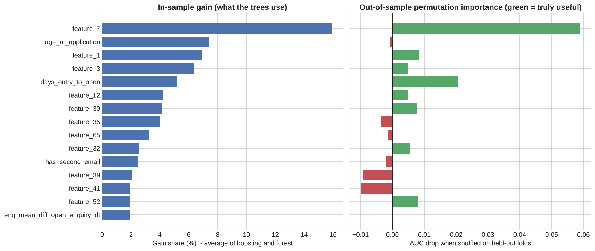

**Reading this honestly:** only about 10 variables are positive out-of-sample. In-sample gain for variables with negative permutation importance (e.g. `age_at_application`) partly reflects memorising noise. Bureau-style features (`enq_mean_diff_open_enquiry_dt`, `enq_perc_unsecured`) appear in the list but are populated for only 5% of customers and add nothing out-of-sample. A model using the 27-variable subset scored **36.7** (selection used all data, so even that is mildly optimistic), so the full regularised model is preferred.

---

## 9. Limitations and honest caveats

1. **33 bad customers.** Every metric is noisy. The 95% CI of 25–64 includes the reference 37.9. The honest statement is "comparable to or better than the reference", not "proven better".
2. **Bureau data barely joins.** Accounts match 8 customers (0 bad), enquiries 50 (4 bad). The reference model's top features are bureau-based, so **this result is not a like-for-like comparison**. With full bureau coverage, these features would likely matter much more.
3. **Anonymised features.** Names such as "limit-like" or "income-like" are inferences from value ranges, not confirmed definitions.
4. **No out-of-time test.** 92% of applications come from two months.
5. **Product-code mapping is assumed** (standard Indian bureau codes, e.g. 10 = credit card). No code book was supplied.
6. **Association is not causation.** "Rented → safer" describes this sample, not a rule.
7. **Possible fairness/regulatory issues.** Residence type, age and education should be reviewed before any production use.
8. **`days_entry_to_open`** may be an operational process artefact rather than customer behaviour; verify it is available at decision time before using it live.

---

## 10. Repository layout and how to run

```
credit-risk-scorecard/
├── README.md
├── pipeline.py     ← COMPLETE PROJECT IN ONE FILE (run this)
├── project_notebook.ipynb  ← same code as a Jupyter notebook
├── REPORT_CARD.md             one-page model report card (also charts/report_card.png)
├── DATA_DICTIONARY.md
├── requirements.txt
├── data/
│   ├── raw/            original three CSVs (unchanged)
│   └── clean/          cleaned tables, customer_master, model_matrix, oof_predictions
├── src/
│   ├── utils.py
│   ├── 01_clean_data.py
│   ├── 02_feature_engineering.py
│   ├── 03_modeling.py
│   ├── 04_eda_charts.py
│   ├── 05_model_charts.py
│   └── run_all.py
├── charts/             16 PNG charts (eda_*, model_*, report_card)
└── outputs/            metrics, rank ordering, feature matrix, data-quality log, saved model
```

```bash
pip install -r requirements.txt
python pipeline.py     # single file: cleaning -> features -> EDA -> model -> charts
# or run the same steps separately:  python src/run_all.py
```
