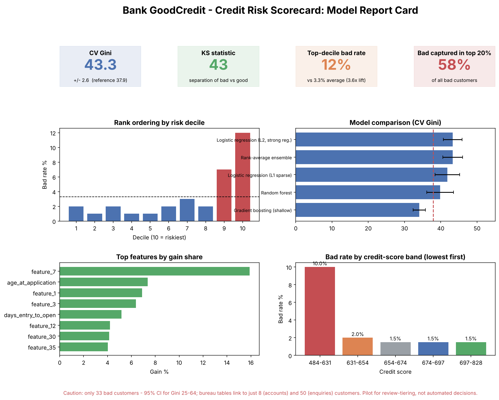

# Model Report Card - Bank GoodCredit Credit Risk Scorecard

| Item | Result |
|---|---|
| Target | `Bad_label` (30+ days past due), 33 bad of 1,000 (3.3%) |
| Model | Logistic regression, L2 strong regularisation |
| Validation | Stratified 5-fold x 5 repeats, preprocessing inside the pipeline |
| **CV Gini** | **43.3 +/- 2.6** (reference 37.9) |
| 95% bootstrap CI | about 25 to 64 |
| KS | 43 |
| Top decile bad rate | 12% (3.6x lift) |
| Bad customers captured in top 20% | 58% |
| Lowest credit-score band (484-631) | 10% bad vs 1.5-2% elsewhere |
| Permutation-test p-value | 0.001 |
| **Verdict** | Useful for **review-tiering / pilot**; not for automated decisions |

**Main caveats:** only 33 bad customers; bureau tables link to 8 (accounts) and 50 (enquiries) customers, so the comparison with the reference is not like-for-like; no out-of-time validation; `feature_*` meanings are inferred.

Full detail: see `README.md`.
